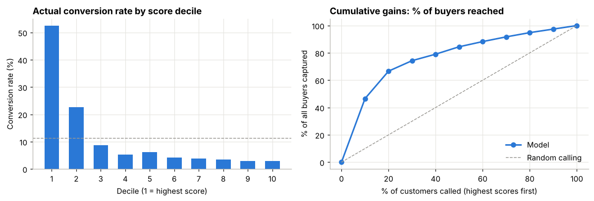
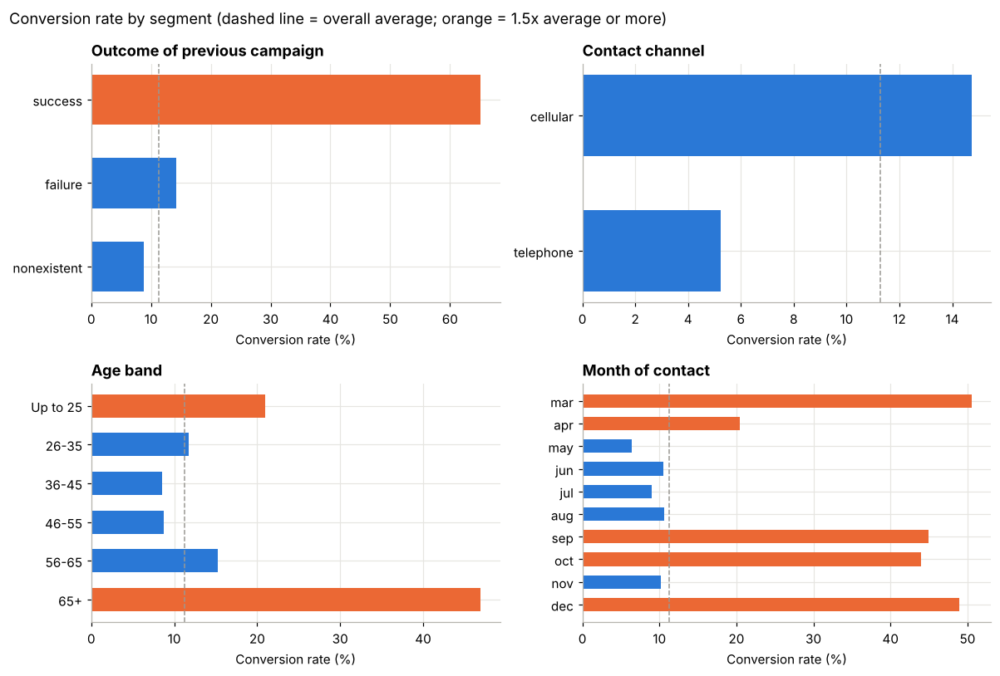

# Bank Campaign Propensity Model & Targeting Strategy

A retail bank sells term deposits through outbound phone campaigns, but **only about 11% of calls convert**. This project finds what drives conversion, builds a model that scores each customer's likelihood to subscribe, and turns that score into a targeting strategy with a clear profit impact.

**Tools:** Python (pandas, scikit-learn, matplotlib), SQL, Excel

## Key results

| | Call everyone (current) | Call top 30% by score |
|---|---|---|
| Calls made | 10,294 | 3,088 (**-70%**) |
| Buyers reached | 1,160 | 862 (**74%** of all buyers) |
| Conversion rate | 11.3% | **27.9%** (2.5x) |

- **Model:** Gradient Boosting, ROC-AUC **0.82** on held-out data. The top score decile converts at **4.7x** the average.
- **Profit:** under illustrative economics (Rs 60 per call, Rs 1,200 per sale), calling the top 50% is profit-optimal at **+12%** vs calling everyone.



## Business insights
1. **Past responders convert at 65%** (vs 11% average). Give them a dedicated re-engagement list.
2. **Mobile converts about 3x better than landline** (14.7% vs 5.2%). Shift channel mix to mobile.
3. **Timing is mis-allocated.** May gets 33% of calls but converts worst (6.4%). Mar, Sep, Oct and Dec convert at 44-51%.
4. **Call fatigue.** Conversion falls from 13% on the 1st call to about 3% after 10+. Cap attempts at about 5.
5. **Life stage.** Over-65s (47%) and under-25s (21%) over-index. Tailor savings messaging to them.
6. **Rate cycle.** Deposit demand is about 5x higher when market rates are low. Plan campaigns around it.



## Approach
1. **Data quality:** removed 12 duplicate rows, kept `unknown` as its own category, and converted the `pdays = 999` code into a "previously contacted" flag.
2. **Avoided target leakage:** dropped `duration` (call length). It is only known after the call, so it cannot be used to decide whom to call.
3. **EDA:** conversion by channel, month, previous outcome, age, occupation, call count and interest-rate regime.
4. **Modelling:** Logistic Regression (interpretable baseline, AUC 0.80) vs Gradient Boosting (AUC 0.82), on a stratified 75/25 split. Evaluated with ROC-AUC, PR-AUC and decile lift, because accuracy is misleading at an 11% positive rate.
5. **Business translation:** gains table, profit curve and targeting-depth recommendation.

## Repository
| File | What it is |
|---|---|
| `bank_campaign_propensity.ipynb` | Full analysis: EDA, model, gains, profit simulation, recommendations |
| `campaign_analysis.sql` | Key analyses in SQL (window functions, CTEs, CASE segmentation) |
| `Campaign_Dashboard.xlsx` | Excel dashboard: segment tables, gains, and a profit simulator (change the yellow inputs on the Assumptions sheet) |
| `charts/` | Exported charts |
| `data/bank-additional-full.csv` | Source data |

## How to run
```bash
pip install -r requirements.txt
jupyter notebook bank_campaign_propensity.ipynb
```

## Limitations and next steps
- The data covers Portugal in 2008-10, so patterns must be re-validated on Indian customer data.
- Validate with an out-of-time test (train on earlier months, test on later) before deployment.
- The unit economics are illustrative assumptions.
- Next step: an **uplift model** that targets customers the call actually *persuades*, not just those who would buy anyway.

## Data source
[UCI Machine Learning Repository: Bank Marketing](https://archive.ics.uci.edu/dataset/222/bank+marketing). Moro, S., Cortez, P., & Rita, P. (2014). *A Data-Driven Approach to Predict the Success of Bank Telemarketing.* Decision Support Systems, 62, 22-31.
